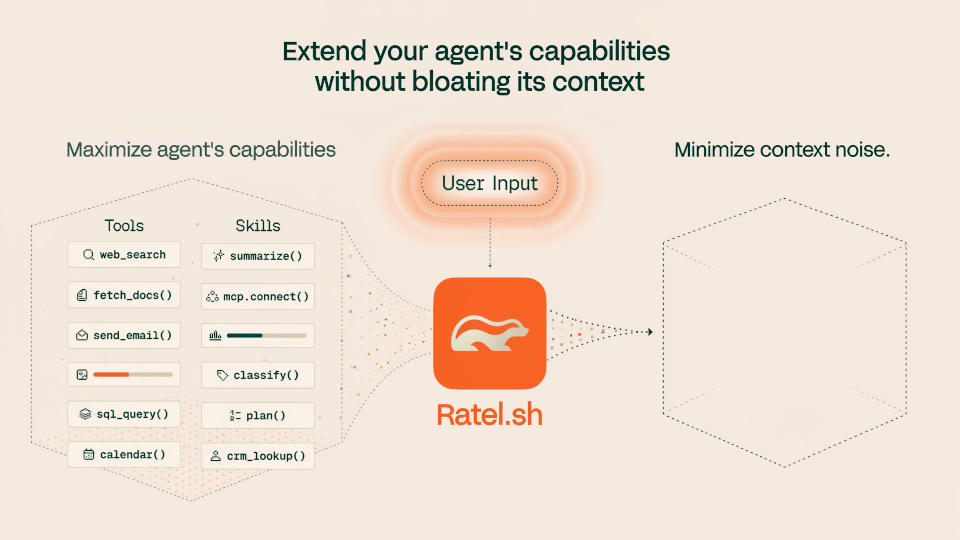

<div align="center">
  <h1>Ratel</h1>
  <p>See what your AI agent gets wrong, and what to change. On your own infrastructure.</p>

  <p>
    <a href="https://docs.ratel.sh">Docs</a> •
    <a href="https://github.com/ratel-ai/skills">Skills</a> •
    <a href="https://discord.gg/75vAPdjYqT">Discord</a>
  </p>

  <p>
    <a href="https://github.com/ratel-ai/ratel/stargazers"></a>
    <a href="https://discord.gg/75vAPdjYqT"></a>
    <a href="#license"></a>
  </p>
</div>

## Introduction

Ratel is a self-hosted platform for AI agents. Your agent sends it traces and its catalog of tools and skills. Ratel reads that traffic and shows you what the agent gets wrong, what people ask it for, and which changes would make it find and finish more.

It is for anyone building or running an agent who wants to see how it behaves and keep that data on their own machines. It runs as one application and one Postgres database, and it needs nothing else:

- **Console:** the pages you read and act on. See [What is in the console](#what-is-in-the-console).
- **Ingest and catalog APIs:** OTLP traces and logs, SDK events, catalog pull, skills and intent graph sync, authenticated with per-project API keys.
- **Background jobs:** a durable queue in Postgres, drained every minute inside the application. There is no separate worker or scheduler to run.
- **Readings:** what Ratel works out from the traffic, as jobs over a ledger of your agent's turns: Agent health signals, workflows and self-corrections, topics, intent clusters and the intent graph, the tool explorer, and match quality.

Model keys are optional. With no key, Ratel makes no outbound model call. The readings that need a model report themselves skipped, workflows keep their tool-order names, and topics are named from their own asks.

## Quick Start

**You need** Docker with Compose 2.24 or later.

### On your machine

```sh
git clone https://github.com/ratel-ai/ratel.git
cd ratel
docker compose up -d --build --wait
```

Open `http://localhost:3000`. The first build takes a few minutes, and no configuration is needed. To name your organization, set `RATEL_ORG_NAME` in `.env` before the first start, or rename it later in Settings.

### Explore with demo data (optional)

```sh
docker compose --profile demo run --rm demo
```

This adds a sample project, Site Copilot, with 30 days of agent activity. Some pages fill in over the next couple of minutes. Run it again to replace the project with a fresh copy.

### On a server

> **The console has no login.** Anyone who reaches it is an admin. Ratel binds to `127.0.0.1` only: keep it behind your own proxy with authentication and TLS.

```sh
git clone https://github.com/ratel-ai/ratel.git
cd ratel
cp .env.example .env
```

Set these in `.env` **before the first start**. Generate each secret with `openssl rand -hex 32`:

```sh
RATEL_ORG_NAME=Acme
BASE_URL=https://ratel.example.com/api/v1
POSTGRES_PASSWORD=<generated>
TRACE_SIGNALS_HASH_SALT=<generated>
```

Then start it with `docker compose up -d --build --wait`. Point your proxy at `127.0.0.1:3000`, and configure it so that:

- `/v1`, `/v2`, `/api/v1` and `/api/v2` pass through without your login, because the SDKs authenticate with API keys.
- Everything else requires your login.
- It preserves `Host` or sets `X-Forwarded-Host`, otherwise console actions fail.

Model keys are optional, and every field is explained in `.env.example`.

### Everyday commands

```sh
docker compose up -d --build --wait    # start, or update after a git pull; migrations run on boot
docker compose down                    # stop, keeping your data
docker compose logs -f web             # follow the logs
docker compose down --volumes          # stop and DELETE ALL DATA
```

`POSTGRES_PASSWORD` is read only when the database is first created. Changing it later means deleting the data with the last command.

## What is in the console

An organization holds projects, and each project is one agent's view:

| Page | What it shows |
|---|---|
| **Overview** | The project at a glance: activity over the last 7 or 30 days, and what needs attention. |
| **Agent health** | What your agent gets wrong. **Summary** lists the issues, **Tasks** follows what people tried to do down to each session, and **Self-corrections** lists the times the agent retried, switched tools, gave up or apologized. The Summary also prints as a report. |
| **Traces** | Every run step by step, with spans, operations and logs, and two traces side by side. |
| **Catalog** | Every **tool** and **skill** your agent can use, and how each one is found. **Test a search** ranks a prompt against the live catalog, with what-if edits. |
| **Intents** | What people ask for. **All intents** lists the topics, **Flows** shows what people want next, ask after ask, and **Map** lays the intents out. |
| **Improvements** | **Fixes** is the one list of changes that would make your agent find and finish more. **Quality** measures how well searches find the right tool, with misses, description rewrites and experiments. **Adaptive ranking** puts the tool your agent needs first, using what people asked before. |
| **Settings** | Projects general settings, **API keys**, SDK events under **Developer**, and a danger zone. |

## Ratel SDKs

The SDKs are how an agent sends data to Ratel and uses its tools. They wrap an in-process retrieval engine that indexes your tools and skills, so the agent searches for what each turn needs instead of loading everything up front. No vector DB and no server are needed for that part, and it works with or without the platform. To send data to your platform, create an API key in the project's Settings, set it as `RATEL_API_KEY` where your agent runs, and export OpenTelemetry to your deployment: see the [telemetry guide](https://docs.ratel.sh/docs/telemetry) and [src/telemetry](src/telemetry/README.md). The full SDK overview is in [README-SDK.md](README-SDK.md).

[](https://www.npmjs.com/package/@ratel-ai/sdk) [](https://pypi.org/project/ratel-ai/) [](https://crates.io/crates/ratel-ai-core)

<div align="center">
  
</div>

```bash
pnpm add @ratel-ai/sdk   # TypeScript
pip install ratel-ai     # Python
```

Guides: [Docs](https://docs.ratel.sh) · [Quickstart](https://docs.ratel.sh/docs/quickstart) · [TypeScript SDK](https://docs.ratel.sh/docs/sdks/typescript) · [Python SDK](https://docs.ratel.sh/docs/sdks/python)

Examples: [All examples](examples/README.md) · [Vercel AI SDK](examples/ai-sdk/README.md) · [Pydantic AI](examples/pydantic-ai/README.md)

Benchmarks: [benchmark.ratel.sh](https://benchmark.ratel.sh)

| Package | Folder |
|---|---|
| `@ratel-ai/sdk`, the TypeScript SDK | [src/sdk/ts](src/sdk/ts/README.md) |
| `ratel-ai`, the Python SDK | [src/sdk/python](src/sdk/python/README.md) |
| `ratel-ai-core`, the Rust retrieval engine | [src/core](src/core/README.md) |
| `@ratel-ai/vercel-ai-sdk`, the Vercel AI SDK adapter | [src/adapters/ts-vercel-ai-sdk](src/adapters/ts-vercel-ai-sdk/README.md) |
| `@ratel-ai/mastra`, the Mastra adapter | [src/adapters/ts-mastra](src/adapters/ts-mastra/README.md) |
| `@ratel-ai/rankers-plugin`, `ratel-ai-rankers-plugin`, experimental decision-model rankers | [src/rankers](src/rankers/README.md) |
| `@ratel-ai/telemetry`, `ratel-ai-telemetry`, OpenTelemetry conventions and helpers | [src/telemetry](src/telemetry/README.md) |

## Related projects

| Project | Repo | What it is |
|---|---|---|
| **ratel-local** | [ratel-ai/ratel-mcp](https://github.com/ratel-ai/ratel-mcp) | The local distribution for your Coding Agents: Ratel in front of your MCP setup. |
| **ratel-bench** | [ratel-ai/ratel-bench](https://github.com/ratel-ai/ratel-bench) | The benchmark harness behind [benchmark.ratel.sh](https://benchmark.ratel.sh). |
| **skills** | [ratel-ai/skills](https://github.com/ratel-ai/skills) | Claude Code, Cursor and Codex skills to work on and improve AI agent codebases. |

## Repo layout

```
apps/
└── web/                       # @ratel/platform: the console, the APIs, the jobs and the readings
packages/
├── brand/                     # @ratel/brand: palette, fonts and logo assets
├── design-system/             # @ratel/design-system: semantic tokens and UI primitives
└── sdk/                       # SDK development commands; sources are under src/
src/
├── core/                      # ratel-ai-core: Rust retrieval engine
├── sdk/ts/                    # @ratel-ai/sdk: TypeScript SDK (NAPI-bound)
├── sdk/python/                # ratel-ai: Python SDK (PyO3-bound)
├── adapters/ts-vercel-ai-sdk/ # @ratel-ai/vercel-ai-sdk: Vercel AI SDK adapter
├── adapters/ts-mastra/        # @ratel-ai/mastra: Mastra adapter
├── rankers/                   # @ratel-ai/rankers-plugin, ratel-ai-rankers-plugin: decision-model rankers
└── telemetry/                 # OTel conventions and helper packages
protocol/                      # catalog-source wire contract
examples/                      # End-to-end SDK examples
e2e/                           # Checks against the installed SDK packages
scripts/                       # Repository checks and release tooling
docs/
├── adr/                       # Architecture decision records
└── assets/                    # Images and other static assets
ee/                            # Manifest for the Enterprise modules
```

The application's own layout and commands are in [apps/web/README.md](apps/web/README.md), and the layers of its core in [apps/web/lib/README.md](apps/web/lib/README.md).

## Development

Prerequisites: Node 24+ and pnpm 10.28+, with Docker for the platform's Postgres. The Rust workspace and the SDKs' native addons need Rust stable (pinned via `rust-toolchain.toml`). The Python SDK also needs Python 3.11 and [`uv`](https://docs.astral.sh/uv/).

- **Ratel Platform:** [apps/web/README.md](apps/web/README.md)
- **Ratel SDK:** [packages/sdk/README.md](packages/sdk/README.md)

## Contributing

- [CONTRIBUTING.md](CONTRIBUTING.md)
- [AGENTS.md](AGENTS.md): for coding agents working in this repo

## License

The `ratel-ai-core` engine is licensed under [Apache-2.0](LICENSE-APACHE), an explicit patent grant for the engine others embed. Everything else (the platform application, SDKs, telemetry helpers, examples) is [MIT](LICENSE.md). See [ADR-0009](docs/adr/0009-licensing.md) for the rationale.
