# Proof: the Evals port (RP-149..RP-152)

The Evals product of frozen ratel-cloud (main, synced at `1ce9942`) ported into the core behind `FF_EVALS` (off by default).

| PR | Branch | Head |
|---|---|---|
| [ratel-ai/ratel#408](https://github.com/ratel-ai/ratel/pull/408) (draft, on #407) | `beluga/rp-149-evals-tables` | `6ceb27bc` |
| [ratel-ai/ratel-platform#137](https://github.com/ratel-ai/ratel-platform/pull/137) (draft, on #135) | `beluga/rp-149-evals-tables` | `179ed57` |

CI on the new top: [ci.md](ci.md).

## Targeted test logs, per task

All runs are `tsx --test` on the named files, from `src/`, at ratel `2e67857e` (each log names its commit). The top `6ceb27bc` only adds `.gitleaksignore` lines.

| Task | What | Log | Result |
|---|---|---|---|
| RP-149 | the 9 tables and their stores (evals, eval_tasks, eval_runs, eval_results, eval_nightly_settings, eval_suite_settings, scorers, eval_scorer_overrides, run_scores), 0055 rerun no-op | [logs/rp-149-tables-stores.log](logs/rp-149-tables-stores.log) | 28 pass, 0 fail |
| RP-150 | jobs `run_eval_set`, `simulate_eval_set`, nightly, run settings, suggestions, live scorers, registry and drain steps; `FF_EVALS` on and off (gate.test) | [logs/rp-150-jobs.log](logs/rp-150-jobs.log) | 94 pass, 0 fail |
| RP-150 | the 6 MCP tools, flag on, and the `FF_EVALS`-off case (each tool forbidden, nothing written); get_eval evalSet; contract, tools/list, get_flag_status | [logs/rp-150-mcp-tools.log](logs/rp-150-mcp-tools.log) | 99 pass, 0 fail |
| RP-151 | the pages: flag-off 404 and routes only in `(evals)` (layout.test), the rail with and without `FF_EVALS`, page models and UI renders with seeded data | [logs/rp-151-pages.log](logs/rp-151-pages.log) | 111 pass, 0 fail |
| RP-152 | the Cloud twin: `cloud-evals` -> `FF_EVALS`, the access and composition tests with ee/src = twin | [logs/cloud-twin-flags.log](logs/cloud-twin-flags.log) | 111 pass, 0 fail |

Typecheck: [OSS](logs/typecheck-oss.log) (no `ee/src`) and [Cloud](logs/typecheck-cloud.log) (`ee/src` = ratel-platform #135 head `d7a6cd1`), both exit 0. [checks.log](logs/checks.log): `check:boundary`, `check:layers`, `check:private` clean. The runs made during the tasks are kept too: `logs/rp-150-all-touched-tests.log` (367 pass), `logs/rp-151-all-touched-tests.log` (350 pass).

## Parity: the 6 MCP tools against ratel-cloud, one seed

[parity/README.md](parity/README.md): the same harness ([ratel-cloud](parity/harness.ratel-cloud.ts), [ratel](parity/harness.ratel.ts)) runs 19 calls over `change_scorer`, `list_scorers`, `change_eval`, `list_evals`, `run_evals` and `get_eval_run` on one seed (one organization, one project, the seat recording) with the stand-in models. After uuids, timestamps and ms timings are normalized ([normalize.py](parity/normalize.py)), [ratel-cloud.normalized.json](parity/ratel-cloud.normalized.json) and [ratel.normalized.json](parity/ratel.normalized.json) are identical: 16 answers and 3 expected refusals.

## The pages, running

A local dev server on the seeded demo project, Evals data made through the real MCP tools, store and job with the local stand-in models.

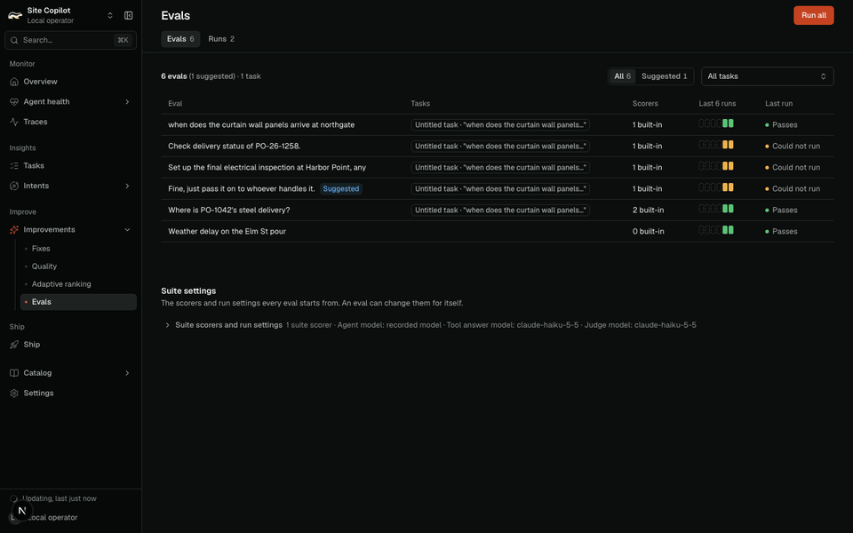

| `FF_EVALS` on | |
|---|---|
| Evals suite, Evals last under Improvements | 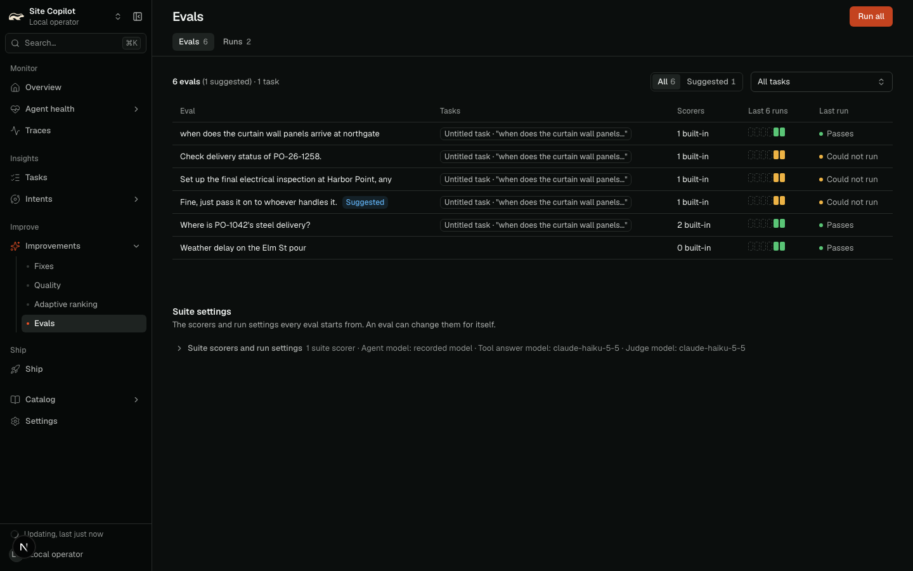 |
| Runs | 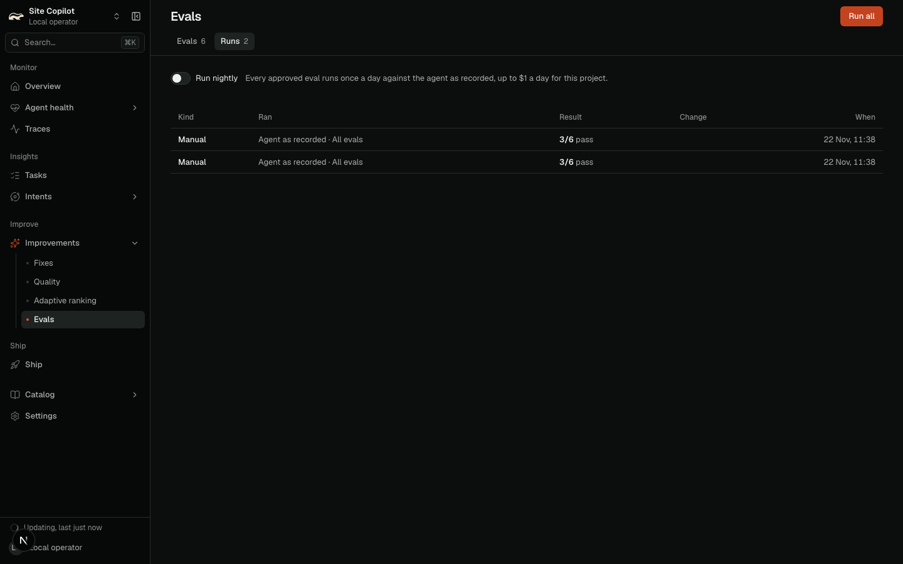 |
| A run | 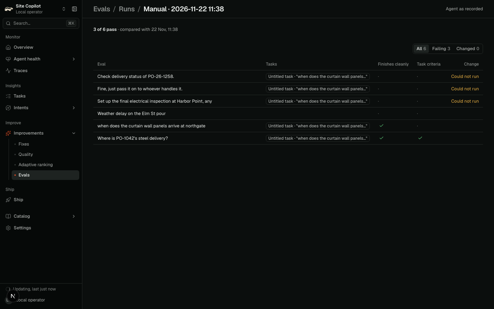 |
| An eval | 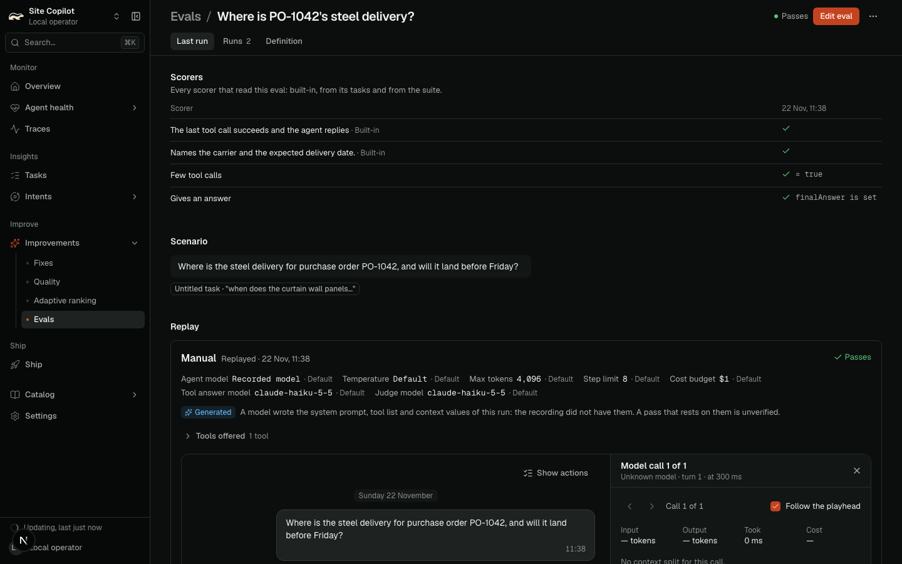 |
| An eval's runs | 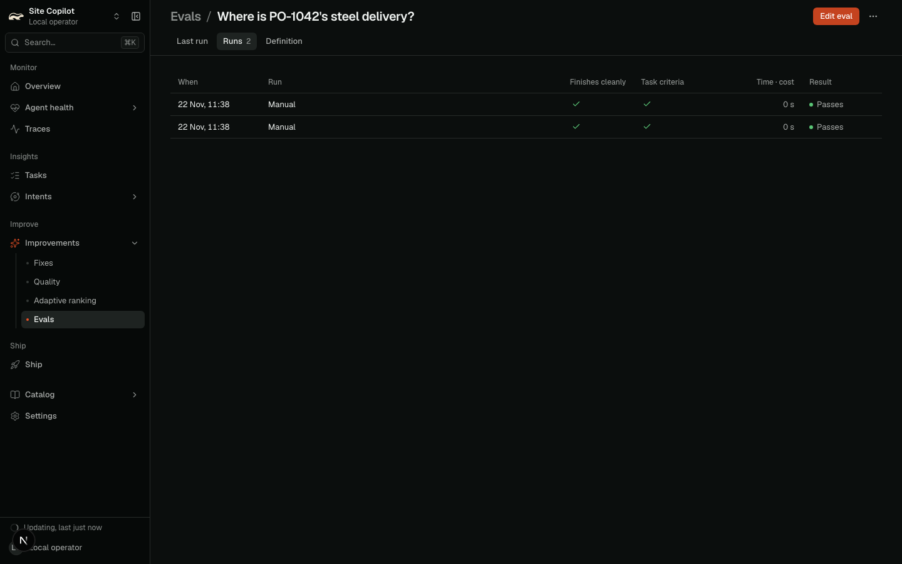 |
| An eval's definition (editor) | 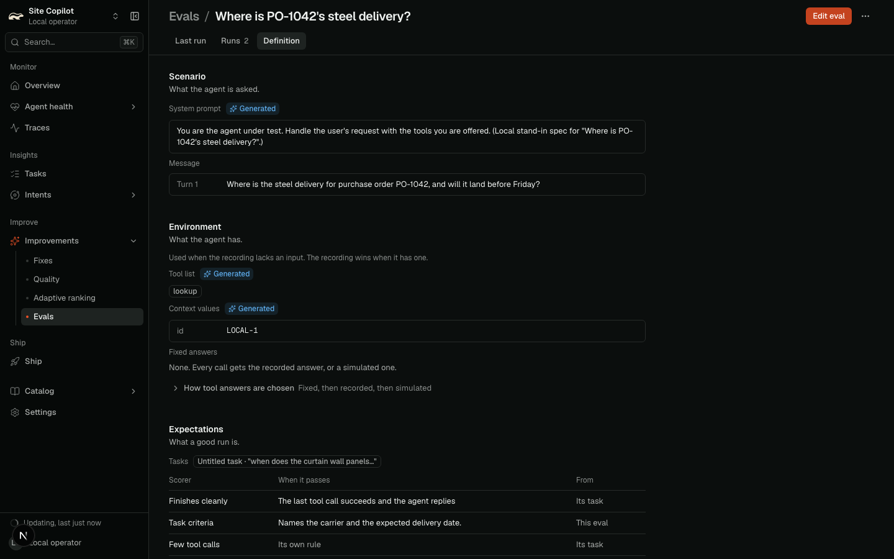 |
| A suite scorer | 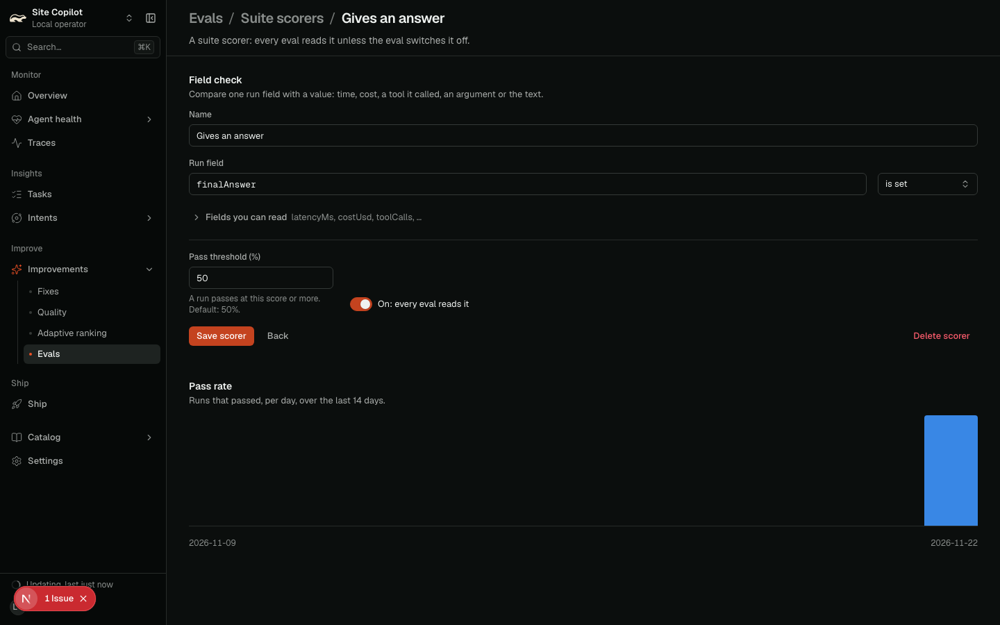 |
| A task scorer (editor and chart) | 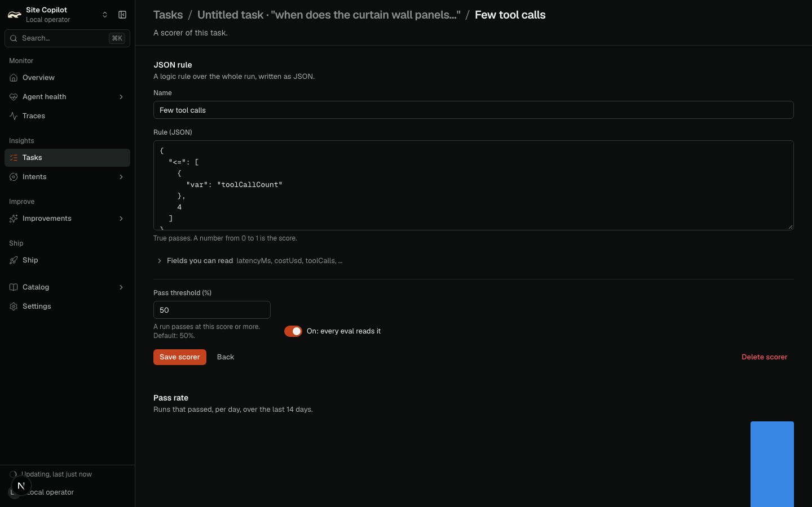 |

| `FF_EVALS` off | |
|---|---|
| An Evals URL is the 404 page | 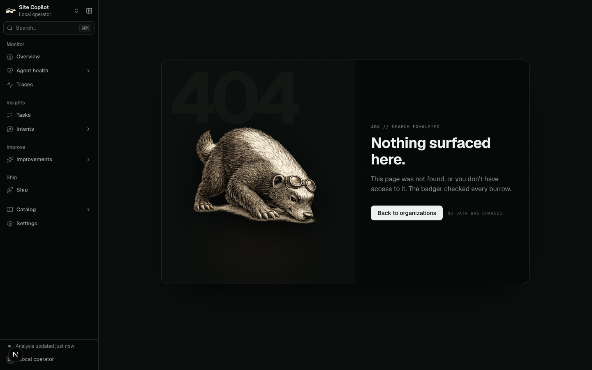 |
| The rail has no Evals item | 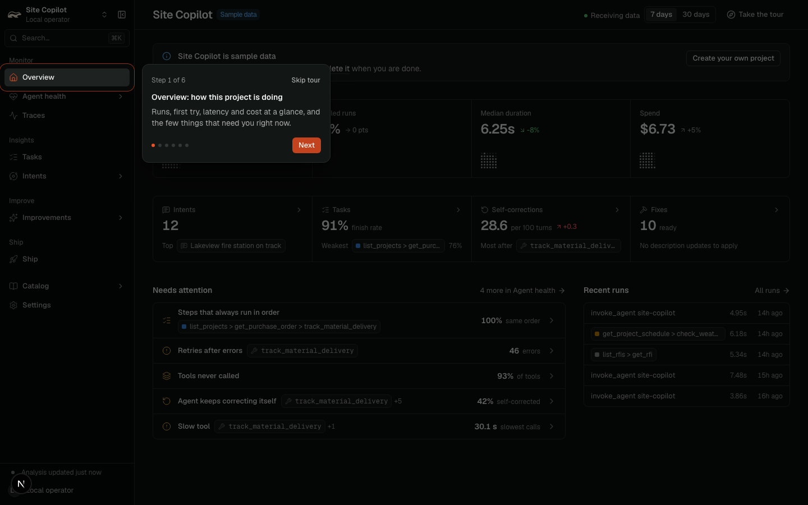 |

[logs/rp-151-flag-off-routes.txt](logs/rp-151-flag-off-routes.txt): with the switch off, the page has no link to `/evals`. Next dev streams the not-found page with status 200; the layout test pins the 404 itself.

Not shown running: the fix page and its simulations (the demo seed has no fix); their page models are covered in `logs/rp-151-pages.log` (fix-page-ui, fix-view) and `logs/rp-150-jobs.log` (simulation).

PR snapshots: [prs/](prs/).
