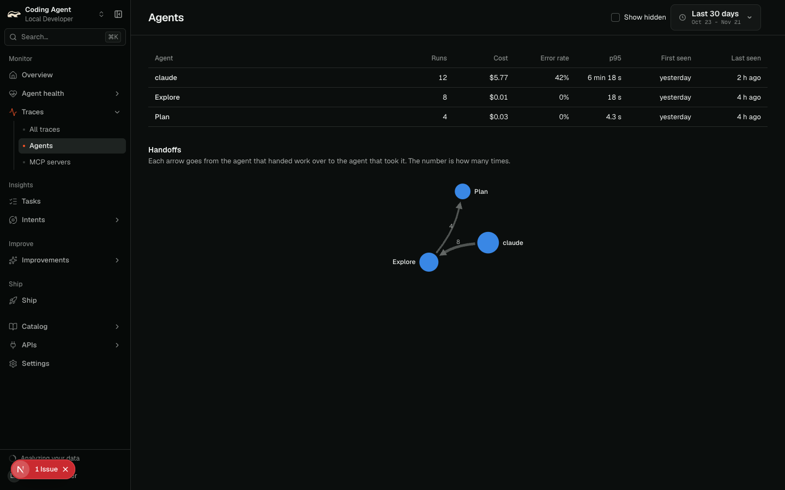
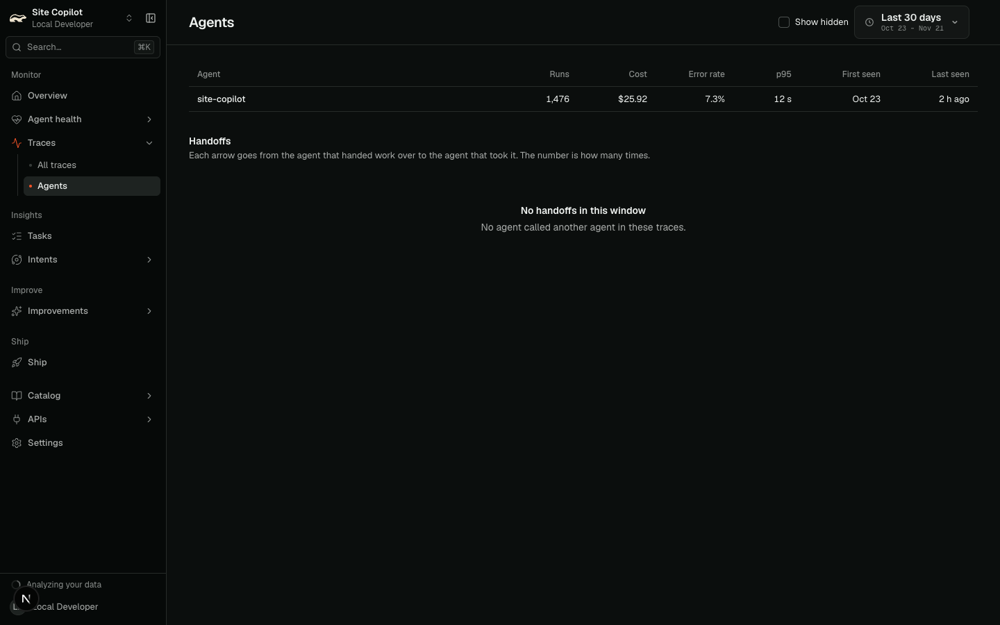
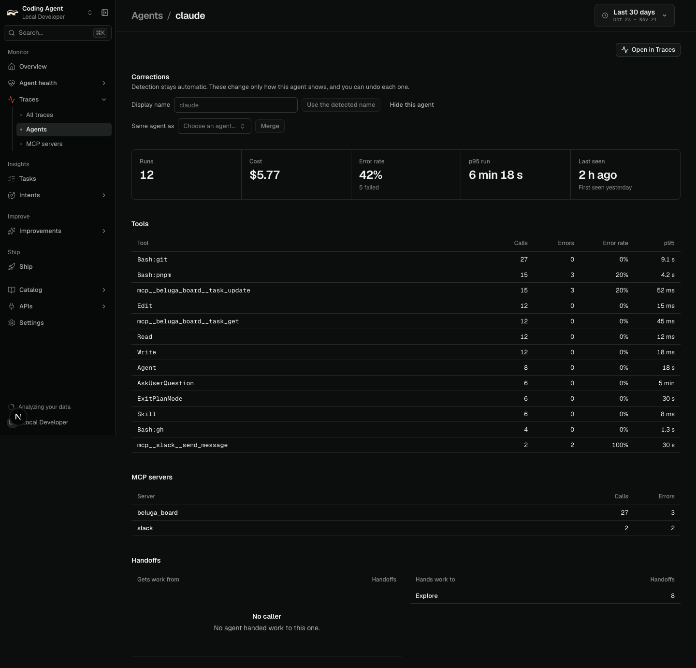
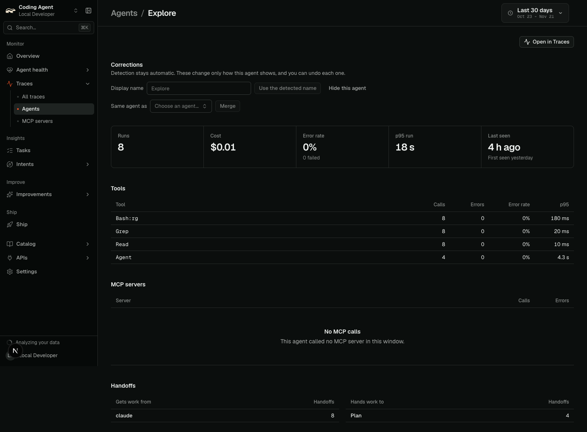
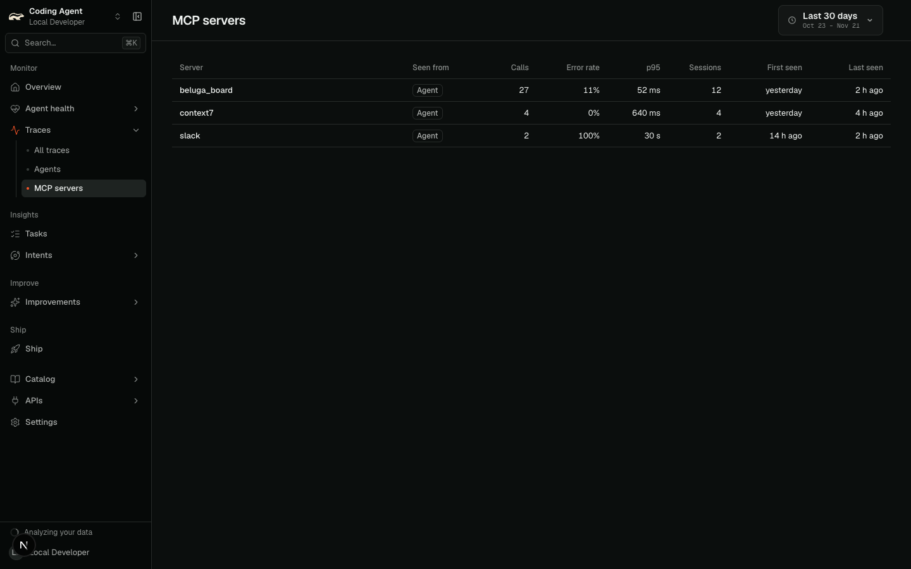
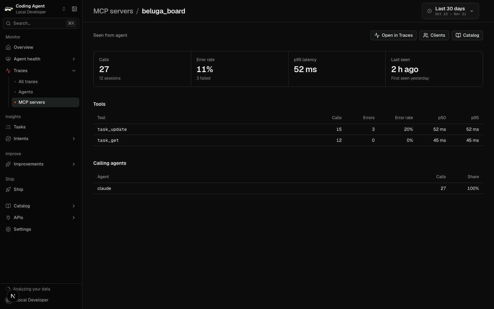
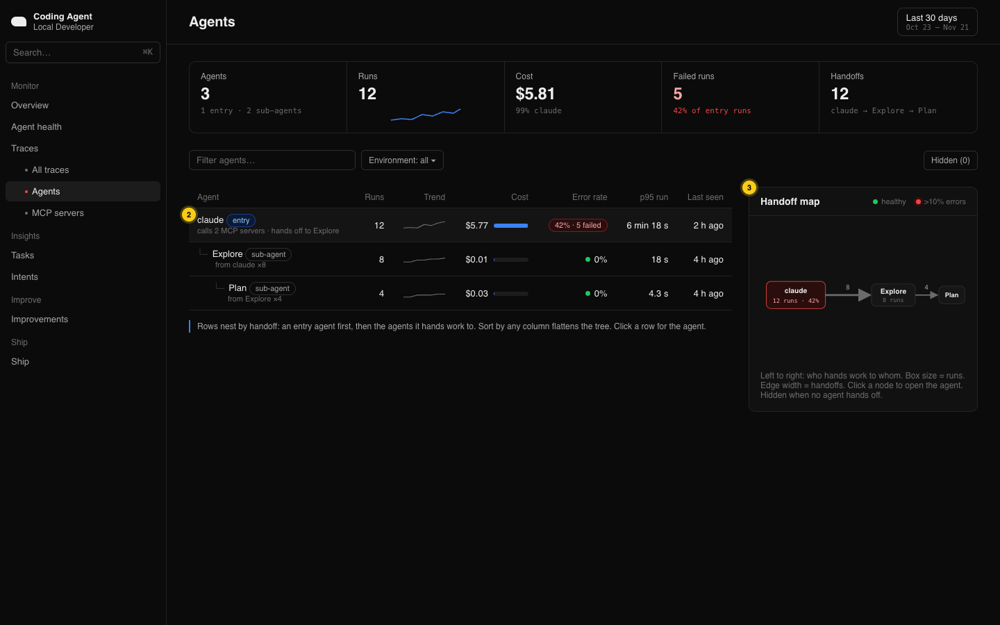
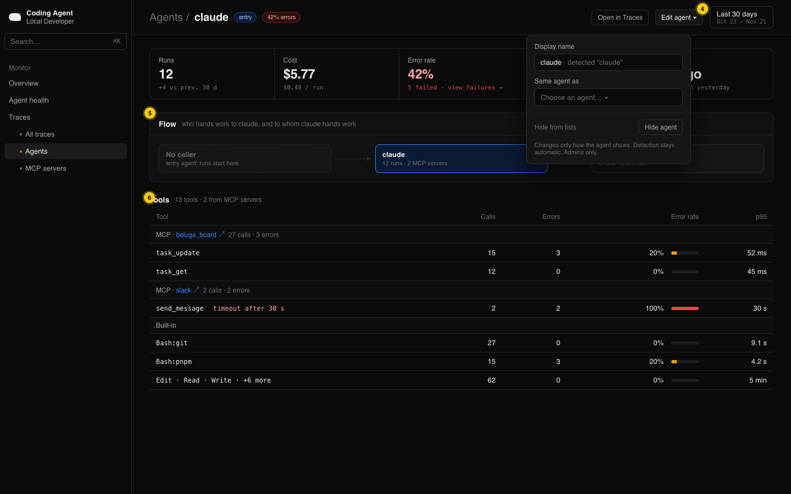
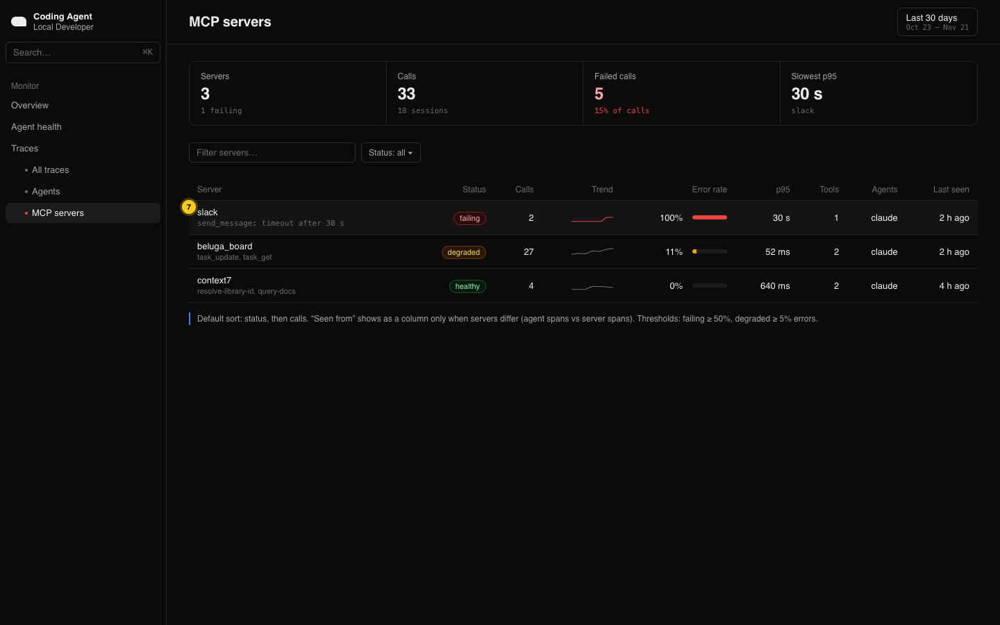
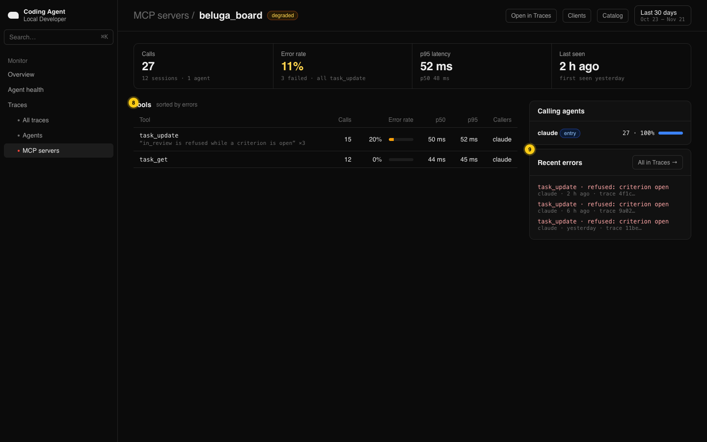

# Agents and MCP servers pages: review and proposal (RP-25)

**Source:** ratel-cloud `origin/main` @ `1ce9942f` (frozen). It runs locally with `DEV_AUTH_BYPASS` and its own DB `ratel_rp25`. The flags come from `.flags.local.example.json`, which includes `cloud-project-entities`. The seeds are **Coding Agent** (`seed-coding-agent.mts`: claude → Explore → Plan, MCP servers beluga_board, context7 and slack) and **Site Copilot** (one agent, no MCP).
**Pages:** Agents (#515: list, handoff graph, overrides) and MCP servers (#510: list, detail).
**For approval in RP-26:** the proposal (section 3) and the open choices (section 4).

---

## 1. Current pages (screenshots)

| Page | Screenshot |
| --- | --- |
| Agents list, 3 agents with handoffs |  |
| Agents list, 1 agent, no handoffs |  |
| Agent detail (claude) |  |
| Agent detail (Explore) |  |
| MCP servers list |  |
| MCP server detail (beluga_board) |  |

## 2. Problems

### Agents list
1. **The page does not show which agent has a problem.** claude has a 42% error rate, but it has the same look as 0%. Nothing sorts or highlights a problem first.
2. **The hierarchy is not in the table.** Agents show as a flat list. You must read the graph to know that Explore and Plan are sub-agents of claude.
3. **The handoff graph uses its space badly.** It has a force layout with 3 small dots in a large empty area. The labels touch the edges. The node size and color carry no data (all nodes are blue). With 1 agent, a full section only says "No handoffs".
4. **There is no summary.** The page has no totals (runs, cost, failures) and no trend.
5. **"Show hidden" is a checkbox in the page header**, next to the date range. It is an admin filter, so it belongs in the filter row with a count.
6. **No search and no environment filter control.** The context reads `?environment=`, but the UI has no control for it.

### Agent detail
7. **The admin corrections come first.** The display name, Hide and Merge fill the top of the page. They push the KPIs and the tools down, and every user sees them, even users who cannot edit.
8. **Tools mix built-in and MCP names.** `mcp__beluga_board__task_update` shows its raw prefix. The MCP servers table below shows the same calls again. The two tables do not link to each other.
9. **Handoffs use two half tables.** Most agents have "No caller" or "No callee", so half of the section is empty.
10. **Nothing gets you to the failures.** "5 failed" is text. It has no link to the failed runs or to an error message.

### MCP servers list
11. **The "Seen from: Agent" badge is the same on each row.** It adds noise and no information.
12. **There is no health status.** slack fails at 100% but has the same look as context7 at 0%. The default sort ignores errors.
13. **Reach is not shown.** The list has no tools count and does not show which agents call each server.
14. **The nav changes with the data.** "MCP servers" is not in the nav for Site Copilot (no MCP calls), but it is there for Coding Agent. The page has a good empty state, so the nav item should always show when the flag is on.

### MCP server detail
15. **There are no error details.** "3 failed" gives no error message and no link to the traces that failed.
16. **p50 equals p95** on small samples (52 ms / 52 ms). The page does not show that the sample is small.
17. **"Clients" and "Catalog"** have the same weight as "Open in Traces". They also go to other parts of the product with no context.

## 3. Proposal (mock screens)

All numbers come from the seeded Coding Agent project, except where marked. The yellow pins match the notes below. The source is `.beluga/scratch/mock/proposal.html`.

### A. Agents list

- **(1) A KPI band:** agents (entry and sub-agents), runs with a trend, cost and its top share, failed runs, and the handoff chain. It fixes 4.
- **(2) A table with a tree:** rows nest by handoff (entry, then its sub-agents), with a role chip, a "from X ×n" line, a runs sparkline, a cost share bar and an error **pill** at more than 10%. A sort by a column flattens the tree. First seen moves to a tooltip. It fixes 1 and 2.
- **(3) A handoff map in a side card:** the layout goes left to right (a DAG, not a force layout), the box size shows runs, the edge width shows handoffs, and the node is red at more than 10% errors. A click on a node opens the agent. The card is **hidden** when there are no handoffs. It fixes 3.
- A filter row with search, an environment control and "Hidden (n)". It fixes 5 and 6.

### B. Agent detail

- **(4) The corrections move into an "Edit agent" menu** in the header, for admins only. The detected name shows next to the field. It fixes 7.
- The header shows the role and status chips. "5 failed · view failures →" opens Traces with a filter for the failed runs of the agent. It fixes 10.
- **(5) A flow strip:** caller → **this agent** → callees in one row, with a dashed "entry agent" box when there is no caller. It fixes 9.
- **(6) Tools are grouped by source:** each MCP server group shows its name and links to its MCP detail. The rows show the tool name without the `mcp__server__` prefix, and a failing tool shows its last error. Then the built-in tools come last, and rare tools fold into "+n more". The separate MCP servers table goes away. It fixes 8. *(The error text "timeout after 30 s" and the "+4 vs prev." delta are illustrative.)*

### C. MCP servers list

- A KPI band (servers, calls, failed calls, slowest p95).
- **(7) A status column** (failing ≥ 50%, degraded ≥ 5%, healthy) with the default sort by status, then by calls. The last error shows under the name of a failing server. The tool names show under the other names. There are Tools and Agents columns and a trend sparkline. It fixes 12 and 13.
- "Seen from" shows only when the rows differ. It fixes 11.
- The nav item always shows when the flag is on. It fixes 14.

### D. MCP server detail

- A status chip in the header. "Clients" and "Catalog" become ghost buttons. It fixes 17.
- The error rate KPI says which tool fails ("all task_update"). It fixes 15.
- **(8) The tools table** sorts by errors, shows the most frequent error under each tool with its count, and adds a Callers column.
- **(9) A "Recent errors" card** shows the tool, the message, the agent, the time and a trace link, plus "All in Traces →". It fixes 15. *(The error messages and the p50 values in the mock are illustrative.)*
- A latency KPI from fewer than 20 calls shows "n = 27" instead of the same p50 and p95. It fixes 16.

### Data it needs (input for RP-27)
- The existing #515 and #510 queries give most of it. **New:** runs and calls per day (sparklines), the last error message per tool and server (from the error attributes of the span), and the parent agent per agent (from the existing handoff edges, to build the tree).
- The MCP tools `list_agents`, `get_agent`, `list_mcp_servers` and `get_mcp_server` must return the same data as the pages, including the status and the role.

## 4. Open choices for the owner (RP-26)
1. **The status thresholds.** Is "failing ≥ 50%, degraded ≥ 5%" for MCP and a "> 10%" error pill for agents correct, or must the thresholds come from Agent health?
2. **The tree vs a flat table.** Should the Agents list nest by handoff by default, as in the proposal, or stay flat with a toggle?
3. **Recent errors.** It needs the error text from the spans, which shows customer data. Is that acceptable on these pages, or must the pages show only a link to Traces?
4. **The page location.** Should the pages stay under Traces in the nav, as in ratel-cloud, or move to Monitor as their own items?
5. **The flag name.** Is `FF_AGENTS_PAGES` correct, or must it be one flag per page?
